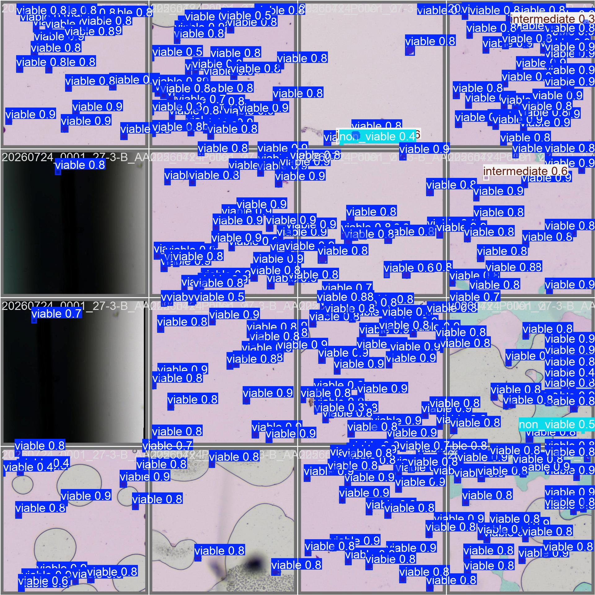
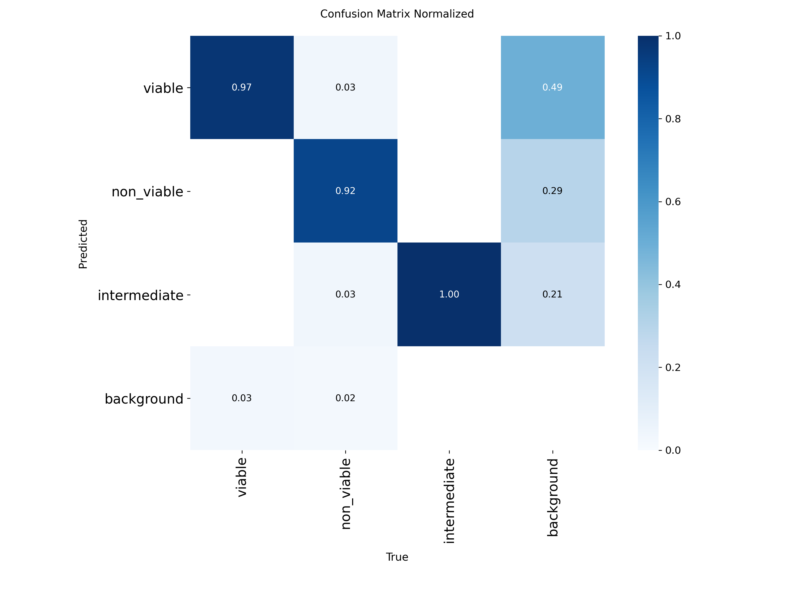
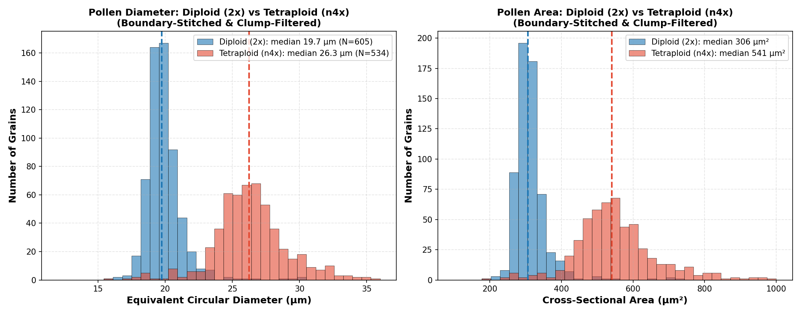

# 🌸 Pollen Viability & Morphometry Analysis Pipeline

[](https://www.python.org/)
[](https://docs.ultralytics.com/)
[](https://kubernetes.io/)
[](https://s3.cl4.du.cesnet.cz)
[](#)

An automated high-throughput computer vision and morphological profiling framework designed to detect, classify, and physically measure pollen grains from high-resolution digital slide scans (**Zeiss Axio Scan**, Alexander Staining). 

The platform supports evolutionary and ecological cytogenetic studies, specifically tracking pollen viability percentages, grain abundance, and cellular size scaling (cross-sectional area and equivalent diameter) across ploidy levels (**natural 2x, synthetic/oryzalin 2x, neo-tetraploid 4x, and natural 4x**), with automated integration of plant experimental metadata and confounding factors.

---

## 📌 Table of Contents
- [🌸 Pollen Viability \& Morphometry Analysis Pipeline](#-pollen-viability--morphometry-analysis-pipeline)
  - [📌 Table of Contents](#-table-of-contents)
  - [🔭 Project Overview](#-project-overview)
  - [🔬 Biological Background \& Staining Protocol](#-biological-background--staining-protocol)
  - [🧠 Machine Learning Architecture \& Model Performance](#-machine-learning-architecture--model-performance)
    - [Model Specification](#model-specification)
    - [Validation Metrics (at 300 Epochs)](#validation-metrics-at-300-epochs)
    - [Confusion Matrix \& Error Breakdown](#confusion-matrix--error-breakdown)
  - [📐 Measurement, Stitching \& Artifact Filtration Methods](#-measurement-stitching--artifact-filtration-methods)
    - [1. Optical Calibration](#1-optical-calibration)
    - [2. Spatial Boundary Stitching Across Tile Cuts](#2-spatial-boundary-stitching-across-tile-cuts)
    - [3. Whole-Scan Margin Exclusion](#3-whole-scan-margin-exclusion)
    - [4. Clumping \& Overlap Filtration](#4-clumping--overlap-filtration)
    - [5. Confounder \& Experimental Metadata Integration](#5-confounder--experimental-metadata-integration)
  - [📊 Preliminary Biological Findings](#-preliminary-biological-findings)
  - [🚀 Running the Pipeline](#-running-the-pipeline)
    - [1. Local Environment Setup](#1-local-environment-setup)
    - [2. Running Sizing \& Stitching on Detection Outputs](#2-running-sizing--stitching-on-detection-outputs)
    - [3. Batch GPU Detection on Kubernetes](#3-batch-gpu-detection-on-kubernetes)
  - [📁 Repository Structure](#-repository-structure)
  - [📄 Collaborator Summary Report](#-collaborator-summary-report)

---

## 🔭 Project Overview

Microscopic evaluation of pollen viability is traditionally labor-intensive, error-prone, and limited to small sample sizes. When comparing ploidy transitions—such as newly synthesized autopolyploids (neo-4x) versus diploid ancestors (2x) and established natural polyploids (4x)—two quantitative traits are paramount:
1. **Viability Percentage:** The proportion of functional, cytoplasm-replete gametes versus aborted, sterile grains.
2. **Cell Size (Gigas Effect):** The physical cross-sectional area and diameter distribution, which scales proportionally with genome duplication.

This pipeline automates the entire analytical lifecycle:
* **Input:** Whole-slide CZI / high-resolution scans tiled at $640\times640$ pixels.
* **Inference:** Polygon-level instance segmentation using YOLO11m-seg trained on curated Alexander-stained pollen slides.
* **Post-processing:** Stitching split grains across tile cuts, excluding boundary cutoffs, filtering out clumps, and converting pixels to microns.
* **Output:** Master slide-level summary tables (`pollen_slide_summaries.csv`) and individual grain morphology profiles (`pollen_grain_measurements.csv`), pre-joined with plant pedigree, population, and cytotype metadata.

---

## 🔬 Biological Background & Staining Protocol

The pipeline processes slides stained using the **Alexander Stain Protocol** (Alexander, 1969; modified for brassicaceous plants), which differentiates functional gametes based on cytoplasmic integrity and enzymatic retention:

| Class | Appearance | Cytoplasm & Wall Status | Biological Interpretation |
| :--- | :--- | :--- | :--- |
| **Viable** (Class 0) | **Deep Magenta / Dark Red** | Intact protoplasm retaining Acid Fuchsin / Malachite Green | Fully developed, viable pollen grain with fertile cytoplasm. |
| **Non-Viable** (Class 1) | **Pale Green / Faint Blue** | Protoplasm absent or severely retracted; only outer exine wall visible | Aborted, inviable, or empty pollen grain. |
| **Intermediate** (Class 2) | **Partial Pink / Uneven Mottling** | Partially collapsed protoplasm or incomplete dye uptake | Sub-viable or developmentally arrested grain. |


*Figure 1: Example YOLO11m instance segmentation masks on Alexander-stained pollen grains.*

---

## 🧠 Machine Learning Architecture & Model Performance

### Model Specification
* **Backbone & Head:** YOLO11 Medium Instance Segmentation (`yolo11m-seg.pt`), with polygon mask output heads.
* **Input Resolution:** $640 \times 640$ pixels (extracted with minimal overlap from whole-slide micrographs).
* **Training Schedule:** 300 epochs on Kubernetes NVIDIA GPU cluster; Cosine annealing learning rate; Mosaic augmentation active for 290 epochs and disabled during the final 10 epochs to preserve boundary fidelity.
* **Optimal Operating Threshold:** Confidence $\mathbf{\text{CONF} = 0.55}$, Class-Agnostic Non-Maximum Suppression $\mathbf{\text{IOU} = 0.45}$ with containment filtering (eliminates duplicate anchor proposals in clusters; peak mask $F_1 = 0.88$).

### Validation Metrics (at 300 Epochs)

| Metric | Overall | Viable (Class 0) | Non-Viable (Class 1) | Intermediate (Class 2) |
| :--- | :---: | :---: | :---: | :---: |
| **Box mAP@50** | **0.939** | 0.982 | 0.933 | 0.901 |
| **Box mAP@50-95** | **0.687** | 0.793 | 0.655 | 0.612 |
| **Mask mAP@50** | **0.937** | 0.982 | 0.927 | 0.901 |
| **Mask mAP@50-95** | **0.573** | 0.697 | 0.550 | 0.472 |
| **Precision** | **0.865** | 0.957 | 0.840 | 0.798 |
| **Recall** | **0.898** | 0.975 | 0.915 | 0.804 |

### Confusion Matrix & Error Breakdown


*Figure 2: Normalized confusion matrix at the validation checkpoint.*

* **Viable Grains:** **$97.3\%$ correct classification** ($652/670$ true viable grains). $0\%$ misclassified as non-viable, $<0.2\%$ classified as intermediate, and only $2.5\%$ missed as background.
* **Non-Viable Grains:** **$91.5\%$ correct classification** ($54/59$ true non-viable grains). Extremely clean boundary between viable and non-viable grains ensures negligible contamination of viability ratios.
* **Background Rejection:** Operating at $\text{CONF} = 0.55$ eliminates spurious background detections and staining precipitates.

---

## 📐 Measurement, Stitching & Artifact Filtration Methods

Microscope slide analysis requires addressing tile boundary artifacts, optical scale conversion, and clump filtering:

### 1. Optical Calibration
All slides are scanned on a calibrated **Zeiss Axio Scan.Z1** slide scanner under standardized optical magnification:
$$\text{Pixel Scale} = 0.877242\ \mu\text{m / pixel}$$
$$\text{Area Scale} = (0.877242)^2 \approx 0.769554\ \mu\text{m}^2\text{ / pixel}^2$$

Individual grain cross-sectional area $A$ is calculated via Green's theorem on polygon vertices, and equivalent circular diameter $D$ is computed as:
$$D = 2 \cdot \sqrt{\frac{A}{\pi}}$$

### 2. Spatial Boundary Stitching Across Tile Cuts
When large slide images are diced into $640\times640$ px tiles, pollen grains falling on grid cutlines are severed into two or more parts across adjacent tiles.
* The analyzer projects all tile-local polygon coordinates into a continuous global slide coordinate space:
  $$(X_{\text{global}}, Y_{\text{global}}) = (X_{\text{tile}} + \Delta X_{\text{offset}}, Y_{\text{tile}} + \Delta Y_{\text{offset}})$$
* An efficient $O(N)$ spatial grid hash indexes grains touching tile borders. Polygons meeting collinearity and spatial adjacency criteria ($dx \le 6\text{ px}$, overlap $> 8\text{ px}$) are merged into a single restored polygon.

### 3. Whole-Scan Margin Exclusion
Pollen grains lying on the outer margin of the entire slide scan are partially truncated by the camera field boundary.
* **Rule:** Grains touching the whole-scan edge or exhibiting straight cut edges are **counted** for slide abundance and viability %, but flagged with `valid_for_size = False` to prevent distorting diameter distributions.

### 4. Clumping & Overlap Filtration
Overlapping grains and multi-grain clusters introduce positive size outliers:
* **Solidity Filter:** Convex hull solidity $< 0.88$ identifies concave multi-grain boundaries.
* **Aspect Ratio Filter:** Major-to-minor axis ratio $> 1.35$ identifies elongated doublets.
* Both are flagged (`is_clump = True`) and isolated from single-grain morphometric comparisons.

### 5. Confounder & Experimental Metadata Integration
Every slide name (e.g. `20260724_0001_27-3-B_AA025_n4x_Pollen_viability.czi`) embeds:
* `plant_ID` (`27-3-B`)
* `population` (`AA025`)
* `cytotype` (`n4x` = neo-4x, `2x` = natural 2x, `s2x` = synthetic 2x, `4x` = natural 4x)
* Slide scan date (`20260724`) and replication status (`rep`).

The pipeline automatically joins each grain with the master experimental register ([`metadata/plant_metadata_540.csv`](metadata/plant_metadata_540.csv)), attaching cultivation runs, chamber numbers, tray coordinates, and parental accessions for mixed-effects linear modeling.

---

## 📊 Preliminary Biological Findings

Testing the calibrated pipeline on representative slides demonstrated a clear genome duplication signal (**cell gigas effect**):

| Cytotype / Ploidy | Slide ID | Viable Median Area ($\mu\text{m}^2$) | Viable Median Diameter ($\mu\text{m}$) | Viability % | Total Grains Counted |
| :--- | :--- | :---: | :---: | :---: | :---: |
| **Natural Diploid (2x)** | `20260724_0006_27-3-D` | **$306.1\ \mu\text{m}^2$** | **$19.74\ \mu\text{m}$** | **$93.8\%$** | 1,482 |
| **Neo-Tetraploid (n4x)** | `20260724_0001_27-3-B` | **$540.8\ \mu\text{m}^2$** | **$26.25\ \mu\text{m}$** | **$90.2\%$** | 1,168 |


*Figure 3: Equivalent diameter distributions for viable pollen grains in natural diploid (2x) vs newly synthesized tetraploid (n4x).*

### Key Observations:
1. **Size Scaling:** Neo-tetraploid viable pollen grains exhibit a **$1.33\times$ increase in linear diameter** and a **$1.77\times$ increase in 2D cross-sectional area**, translating to approximately a **$2.38\times$ volumetric increase**, closely conforming to the theoretical doubling expected under whole-genome duplication (WGD).
2. **Distinct Modality:** Clean separation between 2x and n4x size peaks validates the ability to detect unreduced gametes ($2n$ pollen) and ploidy shifts in mixed pollinations.

---

## 🚀 Running the Pipeline

### 1. Local Environment Setup
```bash
git clone https://github.com/Pollination-Ecology-Group/Pollen_viability.git
cd Pollen_viability
python3 -m venv .venv
source .venv/bin/activate
pip install -r requirements.txt
```

### 2. Running Sizing & Stitching on Detection Outputs
Run the unified analyzer locally on cached or downloaded slide detection JSONs:
```bash
# Analyze a specific slide
python src/pollen_size_analyzer.py --slide-name 20260724_0001_27-3-B_AA025_n4x_Pollen_viability

# Batch process all slides from S3 and export master tables
python src/pollen_size_analyzer.py --all-slides --output-dir output/size_analysis
```

Outputs generated:
* `output/size_analysis/pollen_slide_summaries.csv`: Slide-level summary (counts, viability %, median sizes).
* `output/size_analysis/pollen_grain_measurements.csv`: Individual grain-level table with morphological parameters and joined plant factors.

### 3. Batch GPU Detection on Kubernetes
To run batch inference on the full dataset stored on S3:
```bash
# 1. Update/apply detection script ConfigMap
kubectl create configmap detect-script --from-file=run_detections_s3.py=src/run_detections_s3.py -n stenc-ns --dry-run=client -o yaml | kubectl apply -f -

# 2. Deploy batch GPU job and email watcher
kubectl apply -f k8s/pollen-detect-job.yaml
kubectl apply -f k8s/pollen-detect-email-watcher.yaml

# 3. Monitor live progress
kubectl logs -l job-name=pollen-detect-job -n stenc-ns -f
```

### 4. Interactive Quality Control (QC) & Validation Web Apps
To achieve publishable scientific rigor, human quality control and morphometry audits are conducted through lightweight web apps hosted directly on the CERIT-SC Kubernetes cluster:

| Application | Live Cluster URL | Description | Authorized Users |
| :--- | :--- | :--- | :---: |
| 🌸 **Pollen Viability QC** | [viability-review-stenc.dyn.cloud.e-infra.cz](https://viability-review-stenc.dyn.cloud.e-infra.cz) | Blinded slide tile review (**191 tiles** across 72 slides, 30% inter-rater overlap). Class-agnostic NMS deduplication, missed grain recovery, Roboflow active learning relabel queue (<kbd>R</kbd>), and real-time viability bias quantification. | `jakub`, `eliska` |
| 🌿 **Stomata Precision Review** | [stomata-review-stenc.dyn.cloud.e-infra.cz](https://stomata-review-stenc.dyn.cloud.e-infra.cz) | Companion vegetative morphometry tool. Audits guard cell and pore calipers, companion stomata detection, and border truncation flags to cross-validate gigas effects. | Open / Lab access |

* **Publication Validation Set (`final_20261026_1614`):** 191 tiles stratified across all 4 cytotypes (`ory_2x`: 52, `nat_2x`: 51, `nat_4x`: 44, `neo_4x`: 44), comprising 144 random density tiles and 47 targeted outlier tiles. 57 tiles are evaluated in duplicate by both reviewers to measure inter-rater reliability.
* **Active Learning Export:** Flagged edge cases can be streamed directly as `.zip` or exported as `.csv` from the Results dashboard for one-click ingestion into Roboflow.

---

## 📁 Repository Structure

```text
├── README.md                           # Main documentation & pipeline overview
├── _quarto.yml                         # Quarto website & book configuration
├── index.qmd                           # Quarto web documentation homepage
├── best.pt                             # Current production weights (YOLO11m-seg)
├── metadata/
│   └── plant_metadata_540.csv          # Master registry for the 540 experimental plants
├── src/
│   ├── pollen_size_analyzer.py         # Spatial stitcher, size analyzer, & metadata joiner
│   ├── run_detections_s3.py            # High-throughput batch GPU inference script
│   └── infer_on_czi.py                 # Direct CZI reader & inference utility
├── k8s/
│   ├── pollen-detect-job.yaml          # GPU detection job manifest (Blackwell/A100)
│   ├── pollen-detect-email-watcher.yaml# Email watcher job sending status alerts
│   └── pollen-train-job.yaml           # Model training job manifest
├── docs/
│   ├── figures/                        # Metric curves, confusion matrices, and plots
│   ├── pollen_viability_project_summary.qmd # Collaborator executive summary source
│   └── pollen_viability_project_summary.pdf # Rendered PDF summary report
├── outcomes/
│   └── pollen_viability_report.qmd     # Statistical reporting & ploidy modeling
└── vignettes/
    ├── pipeline_and_methods.md         # Detailed mathematical & algorithmic methods
    ├── routine_detection_manual.md     # Lab operator detection manual
    ├── CESNET_connection_guide.md      # Cluster & S3 connection guide
    └── kubernetes_workflow.md          # K8s job execution guide
```

---

## 📄 Collaborator Summary Report
A standalone, formatted PDF summary report is prepared for co-authors and collaborators:
* **[Download Collaborator Summary PDF](docs/pollen_viability_project_summary.pdf)**

---
*Maintained by the Pollination Ecology Group (PEG).*
