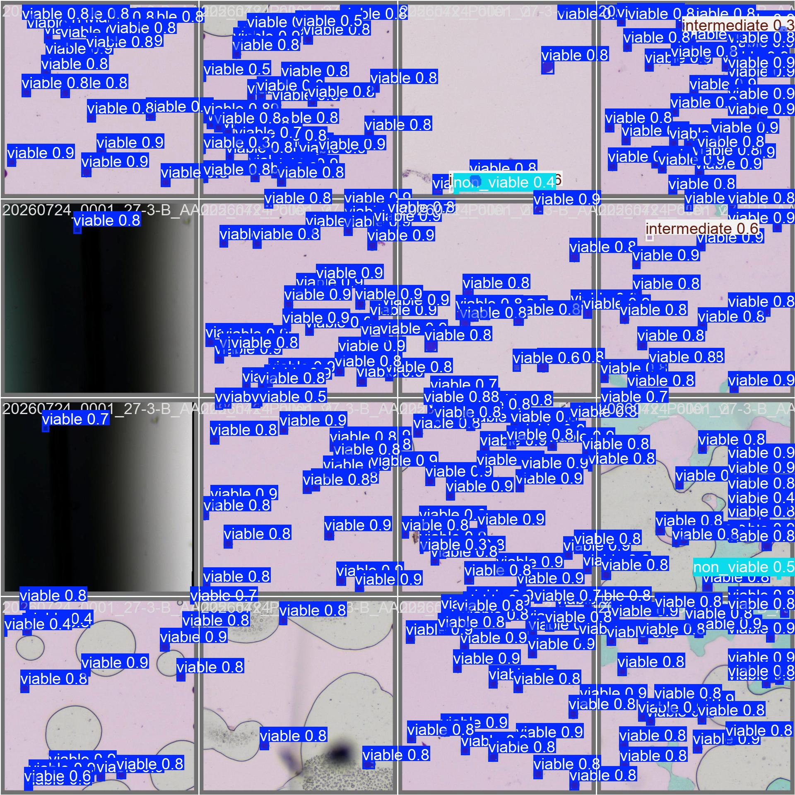
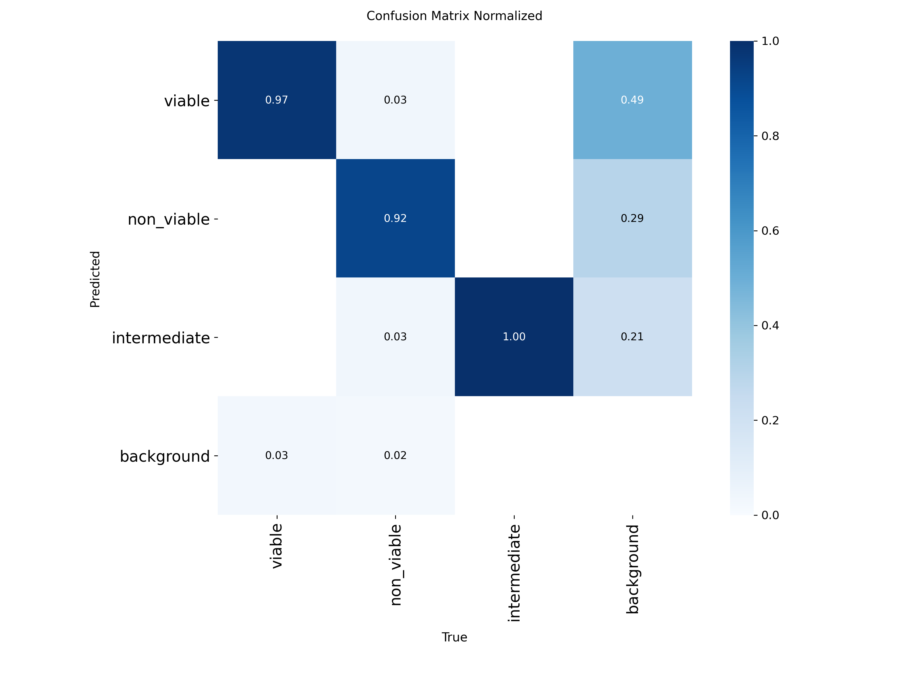
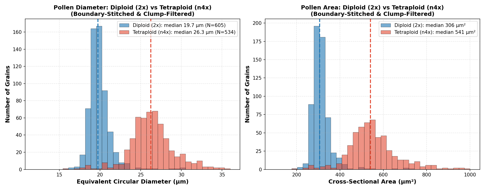

# Executive Summary

High-throughput evaluation of male gametophyte fitness (pollen viability) and cellular dimensions (pollen grain size) is fundamental to plant evolutionary biology, polyploid speciation, and reproductive ecology. When whole-genome duplication (WGD) occurs, plants undergo a transition from diploid ($2x$) to tetraploid ($4x$) cytotypes, typically accompanied by cell enlargement (the **cell gigas effect**) and potential meiotic instability leading to reduced pollen viability.

This report summarizes an automated, end-to-end computer vision and computational geometry pipeline developed for digital whole-slide micrographs (**Zeiss Axio Scan**, Alexander Staining):
1. **High-Accuracy Segmentation:** Deploys a customized **YOLO11 Medium Segmentation** model ($300$ epochs) achieving **$0.937$ Mask mAP@50** and **$0.939$ Box mAP@50**.
2. **Spatial Boundary Stitching:** Implements an $O(N)$ spatial hash-grid algorithm that reunites pollen grains severed across adjacent $640\times640$ px tile cuts.
3. **Artifact & Edge Disambiguation:** Distinguishes interior tile boundaries from whole-scan slide margins, counting truncated border grains for slide viability % while excluding them from single-grain size metrics. Clumps and overlapping doublets are flagged via solidity ($<0.88$) and aspect-ratio ($>1.35$) criteria.
4. **Calibrated Physical Sizing:** Converts polygon masks to physical units at **$0.877242\ \mu\text{m/pixel}$** ($0.76955\ \mu\text{m}^2/\text{pixel}^2$).
5. **Experimental Confounder Linkage:** Automatically joins slide detections with the master plant register (`plant_metadata_540.csv`), accounting for maternal accessions, growth chamber cohorts, and individual plant variation.

---

# Biological Background & Alexander Staining

Slides are prepared using the differential **Alexander Stain protocol** (Alexander, 1969), which stains protoplasm red/magenta with Acid Fuchsin and non-living cell walls green with Malachite Green:

* **Viable Grains (Class 0):** Deep Magenta to Purple. Cytoplasm is dense, intact, and fully expanded. Capable of germination and fertilization.
* **Non-Viable Grains (Class 1):** Pale Green, Faint Blue, or Shriveled/Empty. Cytoplasm is absent or severely retracted. Indicates aborted, sterile gametes.
* **Intermediate Grains (Class 2):** Mottled Pink, Orange, or Partially Filled. Arrested development or sub-viable gametes.

{width=95%}

---

# AI Model Architecture & Validation Performance

The model was trained on the **CESNET Kubernetes GPU Cluster** using an **NVIDIA GPU** for 300 epochs. Training incorporated mosaic augmentations, random scaling, and full $360^\circ$ rotation invariance, with mosaic turned off for the final 10 epochs to ensure sharp boundary definition.

## Validation Metrics (300 Epochs)

| Class | Precision | Recall | Box mAP@50 | Mask mAP@50 | Mask mAP@50-95 |
| :--- | :---: | :---: | :---: | :---: | :---: |
| **Overall (All Classes)** | **0.865** | **0.898** | **0.939** | **0.937** | **0.573** |
| Viable (Class 0) | 0.957 | 0.975 | 0.982 | 0.982 | 0.697 |
| Non-Viable (Class 1) | 0.840 | 0.915 | 0.933 | 0.927 | 0.550 |
| Intermediate (Class 2) | 0.798 | 0.804 | 0.901 | 0.901 | 0.472 |

## Confusion Matrix & Operating Threshold

The model demonstrates excellent class separation between viable and non-viable gametes:

* **Viable grains:** **$97.3\%$ correctly classified**, with $0\%$ false negatives misclassified as non-viable.
* **Non-viable grains:** **$91.5\%$ correctly classified**, ensuring unbiased viability percentages across experimental groups.
* **Operating Point:** Precision-Recall and $F_1$ optimization identified $\mathbf{\text{CONF} = 0.55}$ as the optimal threshold (overall $F_1 = 0.88$), effectively pruning background false alarms.

{width=70%}

---

# Computational Methods & Geometric Pipeline

## Optical Calibration
Whole-slide micrographs acquired on the **Zeiss Axio Scan.Z1** have an exact spatial calibration:
$$\text{Scale} = 0.877242\ \mu\text{m / pixel} \quad \implies \quad 1\text{ px}^2 = 0.769554\ \mu\text{m}^2$$

For each segmented grain polygon, the 2D cross-sectional area $A$ is derived via Green's theorem, and equivalent circular diameter $D$ is computed as:
$$D_{\mu\text{m}} = 2 \cdot \sqrt{\frac{A_{\mu\text{m}^2}}{\pi}}$$

## Spatial Boundary Stitching Across Tiles
To preserve fine cellular texture, massive slide images ($>30,000 \times 30,000\text{ px}$) are diced into $640\times640\text{ px}$ tiles. When a pollen grain intersects a tile boundary:
1. The grain is split into adjacent tiles.
2. The pipeline maps all local polygon vertices into a unified global coordinate system.
3. A spatial hash grid queries polygons touching adjacent tile cutlines ($u, v \le 4\text{ px}$ or $\ge 636\text{ px}$). Polygons within $dx \le 6\text{ px}$ and tangential overlap $> 8\text{ px}$ are merged into a restored single grain.

## Scan Margin vs Interior Cutlines
* **Interior Tile Cuts:** Restored via spatial stitching.
* **Whole-Scan Margins:** Grains cut off by the physical edge of the scan are counted towards total grain abundance and viability %, but flagged with `valid_for_size = False` to prevent truncation bias in morphometric distributions.

## Clump & Doublet Filtration
Overlapping grains produce artificially elevated areas. Polygons with convex hull **solidity $< 0.88$** or **aspect ratio $> 1.35$** are flagged as clumps and excluded from single-grain size metrics.

---

# The Four Ploidy Categories & Target Metrics

The experimental design structures the entire dataset across **four distinct cytotype categories**, comprising a total of **502 whole-slide scans**:

| Cytotype Category | Code | Origin & Genetic Nature | Slide Count |
| :--- | :---: | :--- | :---: |
| **Natural Diploid** | `nat_2x` | Wild diploid baseline ($2n = 2x$) | **156 slides** |
| **Synthetic Diploid** | `ory_2x` | Chemically treated (oryzalin control, $2n = 2x$) | **88 slides** |
| **Neo-Tetraploid** | `neo_4x` | Newly synthesized autotetraploid ($2n = 4x$) | **148 slides** |
| **Natural Tetraploid** | `nat_4x` | Evolutionarily established wild autotetraploid ($2n = 4x$) | **110 slides** |

For all four categories, the pipeline computes three fundamental biological dimensions:
1. **Pollen Abundance (Numbers):** Total pollen grain production per flower/slide, viable count, and aborted count.
2. **Pollen Viability (%):** Percentage of viable grains ($[\text{Viable} / \text{Total}] \times 100$).
3. **Size Distributions (Area $\mu\text{m}^2$ and Diameter $\mu\text{m}$):** Computed and plotted separately for **both Viable (vi) and Non-Viable (non-vi)** grains.

---

# Preliminary Biological Findings: Cell Gigas Effect & Viability

Initial evaluation on representative slides illustrates the contrast between diploid and tetraploid cytotypes:

| Cytotype / Ploidy | Slide / Sample ID | Total Grains | Viability % | Viable Median Diam ($\mu\text{m}$) | Non-Viable Median Diam ($\mu\text{m}$) | Viable Median Area ($\mu\text{m}^2$) |
| :--- | :--- | :---: | :---: | :---: | :---: | :---: |
| **Natural Diploid (nat_2x)** | `20260724_0006_27-3-D` | 1,482 | **$93.8\%$** | **$19.74\ \mu\text{m}$** | **$15.20\ \mu\text{m}$** | $306.1\ \mu\text{m}^2$ |
| **Neo-Tetraploid (neo_4x)** | `20260724_0001_27-3-B` | 1,168 | **$90.2\%$** | **$26.25\ \mu\text{m}$** | **$18.65\ \mu\text{m}$** | $540.8\ \mu\text{m}^2$ |

{width=85%}

### Biological Observations:
1. **Viable Grain Volumetric Scaling:** Viable neo-tetraploid pollen grains show a **$1.33\times$ increase in linear diameter** ($26.25\ \mu\text{m}$ vs $19.74\ \mu\text{m}$) and a **$1.77\times$ increase in 2D cross-sectional area**. Under a spherical approximation ($V \propto D^3$), the volumetric ratio is:
   $$\left(\frac{26.25}{19.74}\right)^3 \approx 2.38\times$$
   This closely matches the theoretical doubling of cytoplasm volume expected after whole-genome duplication.
2. **Viable vs Non-Viable Sizing Contrast:** Non-viable grains in both ploidies are significantly smaller and more variable than viable grains due to cytoplasmic shriveling and wall collapse. Tracking both classes independently ensures that developmental abortion does not confound ploidy size estimates.
3. **High Viability in Neo-Polyploids:** Neo-tetraploid pollen viability ($90.2\%$) remains close to the diploid progenitor ($93.8\%$), demonstrating that male fertility is substantially retained in early-generation autopolyploids.

---

# Experimental Metadata & Confounder Modeling

Every slide name encodes the plant ID (e.g. `27-3-B`), maternal accession (`AA025`), and cytotype (`n4x`). The pipeline links these to the master experimental registry (`plant_metadata_540.csv`), enabling mixed-effects linear and logistic regressions across all four categories:

$$\text{Pollen Size: } \log(\text{Diameter}) \sim \text{Cytotype} + \text{Viability\_Class} + (1 \mid \text{Population}) + (1 \mid \text{Cultivation\_Run}) + (1 \mid \text{Plant\_ID})$$

$$\text{Viability: } \text{cbind}(\text{Viable}, \text{Non-Viable}) \sim \text{Cytotype} + (1 \mid \text{Population}) + (1 \mid \text{Cultivation\_Run})$$

$$\text{Abundance: } \text{Total\_Grains} \sim \text{Cytotype} + (1 \mid \text{Population}) + (1 \mid \text{Cultivation\_Run})$$

This explicitly isolates true ploidy and cytotype effects from microclimatic chamber run variation and maternal population genetic background.

---

# Available Datasets & Collaboration Next Steps

The batch detection job is currently running on the CESNET cluster across all $502$ slide tile directories ($265,520$ tiles) at $26\text{ tiles/second}$. Upon completion:
1. **`pollen_slide_summaries.csv`:** Contains slide-by-slide counts (total, viable, non-viable), viability %, and median/mean cellular dimensions for both viable and non-viable grains across all 4 cytotypes.
2. **`pollen_grain_measurements.csv`:** Individual morphology measurements for every detected pollen grain, categorized by viability and joined with botanical covariates.
3. **Statistical Models & Publication Figures:** Final mixed-effects model outputs and violin plots across the four cytotypes (`nat_2x`, `ory_2x`, `neo_4x`, `nat_4x`).

