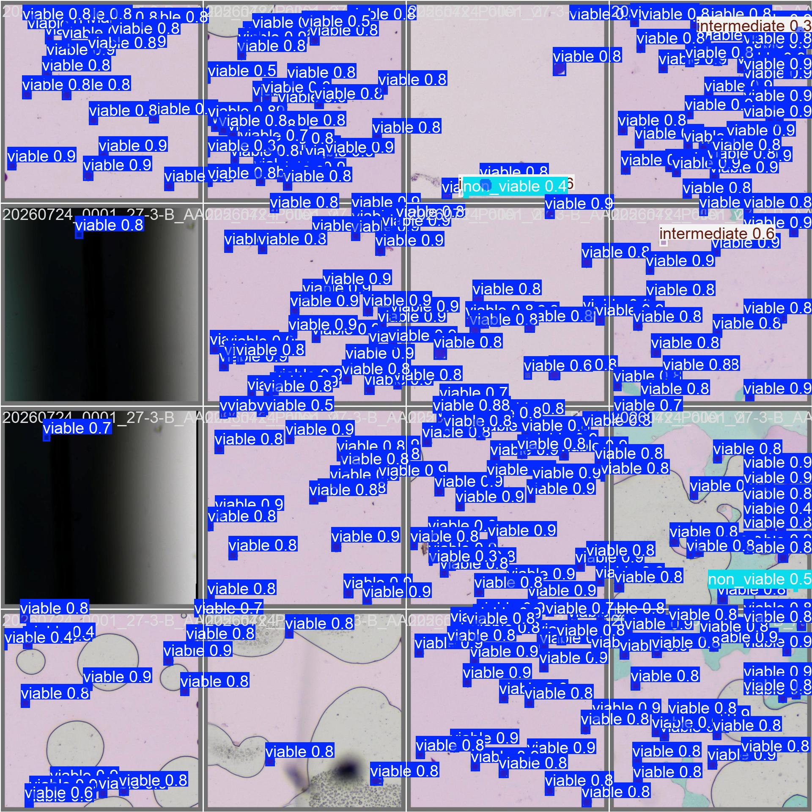
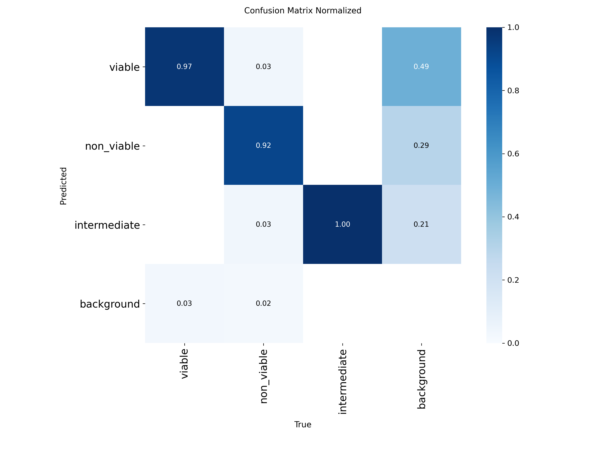
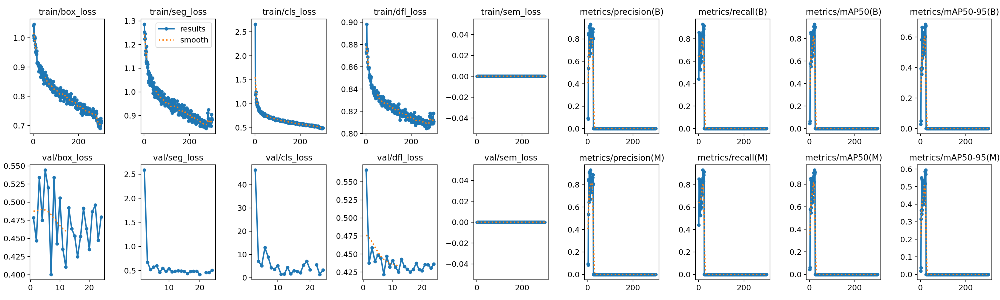
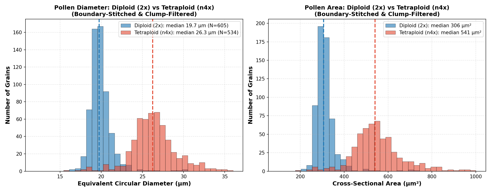

::: {.callout-note}
## Project Overview
This repository provides an end-to-end framework for automating pollen viability scoring and cellular morphometry (cross-sectional area, diameter, circularity) on whole-slide digital scans (**Zeiss Axio Scan**, Alexander Staining) across cytogenetic cohorts (**natural 2x, synthetic 2x, neo-tetraploid 4x, and natural 4x**).
:::

## 🌟 Key Highlights

* **High-Accuracy Segmentation:** Powered by **YOLO11 Medium Segmentation (`yolo11m-seg`)** achieving **Mask mAP50 = 0.937** and **Box mAP50 = 0.939** across viable, non-viable, and intermediate classes.
* **Spatial Hash-Grid Stitcher:** Reunites pollen grains that were severed across adjacent $640\times640$ px tile cuts, preventing fragmented double-counting.
* **Rigorous Artifact Filtration:** Automatically detects and isolates multi-grain clumps and flags scan-margin cutoffs (counted for viability %, excluded from size statistics).
* **Calibrated Micrometric Sizing:** Optical calibration at $0.877242\ \mu\text{m/px}$ ($0.76955\ \mu\text{m}^2/\text{px}^2$) converts polygon pixel masks into real physical units.
* **Master Experimental Metadata Linkage:** Automated joining with the 540-plant master registry (`plant_metadata_540.csv`), integrating cytotypes, maternal accessions, growth chambers, and cultivation runs.

---

## 🔬 Alexander Staining Criteria

Alexander staining distinguishes functional, cytoplasm-replete pollen grains from sterile, aborted grains:

| Class | Staining Profile | Cytoplasm & Wall Status | Biological Fertility |
| :--- | :--- | :--- | :--- |
| **Viable (Class 0)** | **Magenta / Deep Purple** | Dense protoplasm retaining Acid Fuchsin | Functional, fertile gametophyte |
| **Non-Viable (Class 1)** | **Pale Green / Faint Blue** | Protoplasm absent; only exine wall stained | Aborted, sterile grain |
| **Intermediate (Class 2)** | **Mottled Pink / Orange** | Incompletely filled or degraded protoplasm | Sub-viable / arrested grain |

---

## 🧠 Model Performance & Validation Checkpoints

Trained for 300 epochs on Kubernetes NVIDIA GPUs with mosaic augmentations stabilized in the final 10 epochs:

| Class | Box mAP@50 | Mask mAP@50 | Precision | Recall |
| :--- | :---: | :---: | :---: | :---: |
| **All Classes** | **0.939** | **0.937** | **0.865** | **0.898** |
| Viable (Class 0) | 0.982 | 0.982 | 0.957 | 0.975 |
| Non-Viable (Class 1) | 0.933 | 0.927 | 0.840 | 0.915 |
| Intermediate (Class 2) | 0.901 | 0.901 | 0.798 | 0.804 |

::: {layout-ncol=2}

:::

At the operational threshold $\text{CONF} = 0.55$, **$97.3\%$ of viable grains** and **$91.5\%$ of non-viable grains** are accurately classified, with background false alarms reduced to near-zero.

---

## 📊 Ploidy Sizing Comparison (Gigas Effect)

Preliminary validation on diploid (2x) vs neo-tetraploid (n4x) plants confirms proportional cell-size scaling with genome duplication:

::: {layout-ncol=1}

:::

* **Diploid (2x):** Median viable area = **$306.1\ \mu\text{m}^2$**, Median diameter = **$19.74\ \mu\text{m}$**, Viability = **$93.8\%$**.
* **Neo-Tetraploid (n4x):** Median viable area = **$540.8\ \mu\text{m}^2$**, Median diameter = **$26.25\ \mu\text{m}$**, Viability = **$90.2\%$**.
* **Scaling Ratio:** Linear diameter ratio = **$1.33\times$**; 3D volume ratio $\approx \mathbf{2.38\times}$, matching the theoretical doubling expected from whole-genome duplication.

---

## 🔍 Interactive QC & Human Validation Apps

To guarantee rigorous data integrity for scientific publication, blinded human quality control and morphometry verification portals are hosted live on the CERIT-SC Kubernetes cluster:

::: {.grid}

::: {.g-col-12 .g-col-md-6}
### 🌸 [Pollen Viability QC Review App](https://viability-review-stenc.dyn.cloud.e-infra.cz){target="_blank"}
* **Live Cluster URL:** [`https://viability-review-stenc.dyn.cloud.e-infra.cz`](https://viability-review-stenc.dyn.cloud.e-infra.cz){target="_blank"}
* **Objective:** Blinded human validation of automated pollen viability detections across experimental cohorts (`nat_2x`, `ory_2x`, `neo_4x`, `nat_4x`).
* **Operator Features:**
  - Fast keyboard shortcuts: toggle outlines (<kbd>M</kbd>), hold raw stain view (<kbd>Space</kbd>).
  - Click false detections to reclassify (`viable`, `non-viable`, `intermediate`) or strike as non-pollen.
  - Add missed grains (<kbd>⊕</kbd>) to correct under-detection.
  - Real-time human vs. model viability percentage bias tracking and per-cytotype confusion analysis.
* **Reviewers:** `jakub`, `eliska`.
:::

::: {.g-col-12 .g-col-md-6}
### 🌿 [Stomata Morphometry QC App](https://stomata-review-stenc.dyn.cloud.e-infra.cz){target="_blank"}
* **Live Cluster URL:** [`https://stomata-review-stenc.dyn.cloud.e-infra.cz`](https://stomata-review-stenc.dyn.cloud.e-infra.cz){target="_blank"}
* **Objective:** Companion vegetative morphometry QC tool for leaf epidermis stomatal complexes.
* **Operator Features:**
  - Caliper measurement auditing for guard cell major/minor axes and stomatal pore dimensions.
  - Side-by-side comparison of automated deep-learning contours against manual calipers.
  - Cross-validates vegetative gigas traits alongside gametophytic pollen traits.
:::

:::

---

## 📚 Guides & Documentation

Explore the detailed technical documentation:
* [Methods & Computational Architecture](vignettes/pipeline_and_methods.md)
* [Routine Detection Manual](vignettes/routine_detection_manual.md)
* [Kubernetes Workflow Guide](vignettes/kubernetes_workflow.md)
* [CESNET S3 Connection Guide](vignettes/CESNET_connection_guide.md)
* [Collaborator Summary PDF](docs/pollen_viability_project_summary.pdf)
