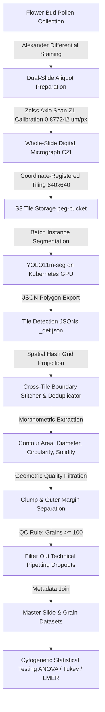

# Pipeline Architecture & Computational Methods

## 1. Overview
The automated pollen viability and morphometry pipeline bridges digital whole-slide microscopy, deep-learning instance segmentation, spatial geometry, and mixed-effects statistical genetics. 

---

## 2. Sample Preparation & Digital Whole-Slide Scanning

### 2.1 Alexander Differential Cytochemical Staining
Pollen samples were collected from mature flowers at anthesis and prepared following Alexander’s differential staining protocol (Alexander, 1969), optimized for Brassicaceae gametophytes:
* **Viable Grains (Class 0):** Possess intact, functional vegetative and generative protoplasm. Protoplasmic proteins strongly bind **Acid Fuchsin**, imparting an intense, opaque magenta to dark red coloration.
* **Non-Viable Grains (Class 1):** Aborted, desiccated, or unfertilized microspores lack cytoplasmic content. Their exposed cellulosic and exine walls bind **Malachite Green**, staining pale turquoise/green, often appearing collapsed, empty, or crenulated.
* **Intermediate Grains (Class 2):** Partially arrested or vacuolated grains displaying mottled, pale pink cytoplasm.
* **Replicate Aliquot Design:** For each biological flower sample, the stained pollen suspension was divided into two identical aliquots and mounted under separate glass coverslips as **primary** and **replicate (sister)** slides to control for liquid-handling and pipetting variability.

### 2.2 Whole-Slide Digital Scanning (Zeiss Axio Scan.Z1)
Whole-slide imaging was conducted on an automated **Zeiss Axio Scan.Z1** slide scanner under calibrated brightfield optics:
* **Optical Train:** Plan-Apochromat objective with calibrated numerical aperture, paired with a multi-channel digital camera sensor.
* **Spatial Calibration Scale:** The physical spatial pixel resolution is strictly calibrated to:
  $$\text{Pixel Scale} = 0.877242\ \mu\text{m} / \text{pixel}$$
  $$\text{Area Scale} = (0.877242)^2 \approx 0.769554\ \mu\text{m}^2 / \text{pixel}^2$$
* **Autofocus Mesh:** A pre-scan focus grid was established across the coverslip area using multi-point surface interpolation to prevent out-of-focus tiles across the specimen field.
* **Tiling & File Organization:** Each full-resolution slide scan was systematically diced into coordinate-registered $640 \times 640$ pixel JPEG tiles. Tile spatial offsets are embedded directly into the standardized filename:
  $$\langle\text{Slide\_ID}\rangle\text{\_tile\_}\langle Y_{\text{offset}}\rangle\text{\_}\langle X_{\text{offset}}\rangle\text{.jpg}$$
  All tiles were archived and synchronized to high-throughput CESNET S3 object storage (`peg-bucket`) under the path `Ostatni/Pollen_viability/tiles_640/`.

---

## 3. Deep-Learning Instance Segmentation (YOLO11m-seg)

### 3.1 Network Architecture & Training Protocol
Object detection and contour extraction were performed using **Ultralytics YOLO11m-seg** (medium segmentation variant):
* **Backbone & Neck:** Enhanced CSPDarknet with C3k2 feature integration and Spatial Pyramid Pooling Fast (SPPF), optimizing multi-scale feature representations of tightly spaced pollen grains.
* **Segmentation Head:** A dual-branch detection and mask-prototype head generates high-resolution mask prototypes ($160 \times 160$ per tile) modulated by instance-specific mask coefficients.
* **Training Hyperparameters:**
  * Epochs: 300 epochs with AdamW optimizer and cosine learning rate decay.
  * Image Resolution: $640 \times 640$ pixels.
  * Augmentation Schedule: Mosaic, rotation, and color jitter augmentations were applied across epochs 1–290 and deactivated during the final 10 epochs (epochs 291–300) to ensure high-fidelity, unblurred polygon boundaries.
* **Classes:**
  * `0: viable` (Acid Fuchsin-positive, cytoplasmic integrity)
  * `1: non_viable` (Malachite Green-positive, aborted/empty)
  * `2: intermediate` (mottled/transitional)

### 3.2 Kubernetes Batch Inference Pipeline
Inference was executed in parallel across NVIDIA GPU worker nodes within the CESNET Kubernetes cluster (`stenc-ns` namespace):
* **Inference Parameters:**
  * **Confidence Threshold ($\text{CONF}$):** $0.55$ (optimized against validation annotations to balance precision and recall).
  * **Non-Maximum Suppression ($\text{IOU}$):** $0.70$ (allows adjacent, touching pollen grains to be resolved as distinct instances while suppressing duplicate bounding boxes).
  * **Maximum Dimension ($\text{MAX\_DIM}$):** $130\ \text{px}$ (rejects large staining debris, coverslip dust fibers, and massive air-bubble boundaries).
* **Tile JSON Output:** For every detected grain, the model emits:
  * Class identifier and classification confidence score ($c \ge 0.55$).
  * Bounding box coordinates $[x_1, y_1, x_2, y_2]$ in local tile coordinates.
  * Normalized polygon contour coordinates $\{ (u_k, v_k) \}_{k=1}^m$ describing the precise boundary mask.
  Each tile's predictions were serialized to `<tile_name>_det.json` and saved to S3.

---

## 4. Post-Processing, Spatial Stitching & Morphometry

### 4.1 Global Coordinate Projection
Each local vertex $(u_k, v_k) \in [0, 640] \times [0, 640]$ within a tile located at grid coordinate $(X_0, Y_0)$ is translated into whole-slide coordinate space:
$$X_{\text{global}} = X_0 + u_k, \quad Y_{\text{global}} = Y_0 + v_k$$

### 4.2 Cross-Tile Stitching & Boundary Deduplication
Because pollen grains frequently span the cut line between adjacent $640 \times 640$ tiles, a dedicated spatial stitching algorithm reconciles bisected instances:
1. **Tile Border Proximity Tagging:** Grains located within $\delta = 4\text{ px}$ of a tile edge ($u \le 4$, $u \ge 636$, $v \le 4$, or $v \ge 636$) are tagged as border-cut candidates.
2. **Spatial Hash Grid:** A 2D spatial hash grid with bin width $W_{\text{bin}} = 64\text{ px}$ indexes border candidates across neighboring tiles.
3. **Polygon Fusion & Re-contouring:** Two candidate segments $P_A$ and $P_B$ from adjacent tiles sharing the same classification class are fused into a single unified polygon if their normal distance $\Delta_{\text{boundary}} \le 6\text{ px}$ and tangential overlap $\ge 8\text{ px}$.
4. **Overlap Deduplication:** For adjacent tiles with overlapping capture zones, detections sharing an Intersection-over-Union $\text{IoU} \ge 0.50$ are deduplicated, preserving the detection instance with higher confidence.

### 4.3 Morphometric Feature Extraction
For each stitched, validated polygon contour, geometric traits are calculated:
* **Contour Area ($A_{\text{px}}$):** Computed via Green's Theorem (shoelace formula) over ordered vertices $\{ (x_i, y_i) \}_{i=0}^{n-1}$:
  $$A_{\text{px}} = \frac{1}{2} \left| \sum_{i=0}^{n-1} (x_i y_{i+1} - x_{i+1} y_i) \right|$$
* **Calibrated Physical Area ($A_{\mu\text{m}^2}$):**
  $$A_{\mu\text{m}^2} = A_{\text{px}} \times (0.877242)^2 \approx A_{\text{px}} \times 0.769554\ \mu\text{m}^2$$
* **Equivalent Circular Diameter ($D_{\mu\text{m}}$):** The diameter of a circle having an identical cross-sectional area:
  $$D_{\mu\text{m}} = 2 \cdot \sqrt{\frac{A_{\mu\text{m}^2}}{\pi}} = 0.877242 \cdot \sqrt{\frac{4 A_{\text{px}}}{\pi}}$$
* **Perimeter ($P$) & Circularity ($C$):**
  $$P = \sum_{i=0}^{n-1} \sqrt{(x_{i+1} - x_i)^2 + (y_{i+1} - y_i)^2}$$
  $$C = \frac{4 \pi A}{P^2} \quad (C = 1.0 \text{ for a perfectly spherical grain})$$
* **Solidity ($S$):** The ratio of the contour area to the area of its 2D convex hull:
  $$S = \frac{A}{\text{Area}(\text{ConvexHull}(A))}$$

### 4.4 Morphological Quality Filtering (Size Validity)
To prevent biased size distributions:
1. **Outer Slide Margin Exclusion:** Grains clipped by the outer borders of the coverslip or imaging boundary cannot have their true area recovered. They are retained in total abundance and viability calculations, but tagged `valid_for_size = False`.
2. **Clump & Precipitate Rejection:** Multi-grain clumps, overlapping clusters, and irregular dye precipitates produce severe concave indentations or elongated profiles. Instances with solidity $S < 0.88$ or aspect ratio $\text{AR} > 1.35$ are tagged `is_clump = True` and excluded from single-grain size metrics (`valid_for_size = False`).

---

## 5. Quality Control: The Technical Pipetting Failure Rule

### 5.1 Rationale & Empirical Investigation
In whole-flower pollen assays, pollen grains are dislodged into an aqueous staining medium and aliquoted onto slides. Sister slides (primary and replicate) were prepared from the same floral homogenate to detect and account for liquid-handling errors.

During whole-dataset inspection across all 502 slides, 10 slides (1.99%) exhibited anomalously low grain counts ($< 100$ grains, with some slides showing fewer than 20 grains). Inspection of raw image tiles and paired sister slides revealed:
1. **Physical Artifacts:** The affected slides exhibited sparse, empty coverslip areas resulting from technical fluidics issues during slide preparation (e.g., micropipette tip capillary blockage, air bubble aspiration, or uneven droplet spreading under the coverslip).
2. **Biological Sister Concordance:** In all 10 cases, the corresponding sister slide from the exact same plant specimen contained normal, dense pollen populations ranging from **$600$ to over $3,100$ grains** with typical high viability ($> 85\%$).
3. **Model Fidelity:** Verification of image tiles confirmed the YOLO model performed correctly; tiles on low-count slides were genuinely devoid of pollen grains or showed out-of-focus fluid boundaries.

### 5.2 Formal QC Exclusion Rule
$$\text{Inclusion Criterion: } \text{Total Grains per Slide} \ge 100$$

* Slides failing this threshold ($N_{\text{total}} < 100$) are classified as **technical pipetting failures** and excluded from slide-level abundance, viability, and morphometric comparisons.
* Because the sister slide remains in the dataset, **no biological plants or cytogenetic lineages are lost**, eliminating liquid-handling noise while preserving complete cytogenetic representation.

---

## 6. Experimental Metadata Linkage & Statistical Modeling

### 6.1 Plant Metadata Integration
Every slide identifier (e.g., `20260724_0001_27-3-B_AA025_n4x_Pollen_viability`) is cross-referenced with `metadata/plant_metadata_540.csv` to map:
* `plant_id`: Individual maternal plant identifier (e.g., `27-3-B`).
* `population`: Wild geographical accession origin (e.g., `AA025`, `AA310`, `AA012`, `AA225`, `AA372`).
* `cytotype`:
  * `nat_2x`: Natural diploid wild ancestor ($2n = 2x$).
  * `ory_2x`: Chemically treated synthetic diploid control ($2n = 2x$, treated with oryzalin but un-duplicated).
  * `neo_4x`: Newly established synthetic autotetraploid ($2n = 4x$).
  * `nat_4x`: Established natural autotetraploid ($2n = 4x$).
* `cultivation_run`: Controlled environmental growth cohort (Run 1 vs Run 3).

### 6.2 Statistical Testing Framework
All hypothesis testing is executed in R:
1. **Analysis of Variance (ANOVA):** Tests the global main effect of cytotype on log-transformed abundance ($\log(\text{total\_grains})$), pollen viability percentage, and median viable grain diameter ($D_{\mu\text{m}}$).
2. **Post-Hoc Pairwise Comparisons (Tukey HSD):** Evaluates all six pairwise cytotype contrasts with family-wise error rate control ($\alpha = 0.05$), accompanied by Compact Letter Displays (CLD).
3. **Linear Mixed-Effects Models (`lme4::lmer`):**
   $$Y_{ijk} = \beta_0 + \beta_1 \text{Cytotype}_i + u_{\text{pop}, j} + v_{\text{run}, k} + \epsilon_{ijk}$$
   Where $u_{\text{pop}, j} \sim \mathcal{N}(0, \sigma^2_{\text{pop}})$ captures genetic background variation across wild populations, and $v_{\text{run}, k} \sim \mathcal{N}(0, \sigma^2_{\text{run}})$ captures environmental batch variation between cultivation runs. Degrees of freedom and $p$-values are computed via Satterthwaite’s approximation (`lmerTest`).
